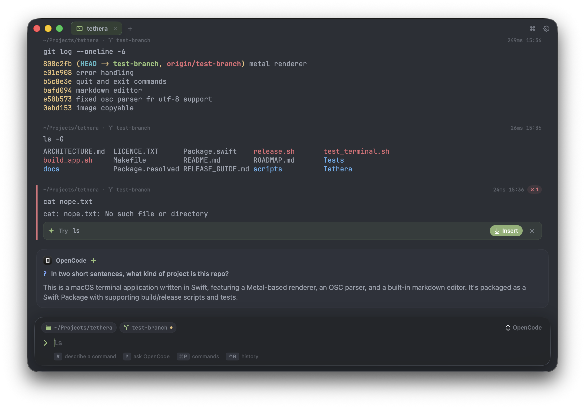

Tethera 0.3 rewrites the terminal core and the UI.

**Download `Tethera-macOS.dmg` below**, open it and drag Tethera to Applications. The build isn't notarized yet: the first time, right-click Tethera.app → Open → Open (or run `xattr -dr com.apple.quarantine /Applications/Tethera.app`). Requires macOS 14 or later; universal (Apple silicon + Intel).

### Terminal
- Every tab is a real pseudo-terminal running your login shell. Output streams live with full ANSI color, and keys go to the running program (`vim`, `htop`, `less`, `ssh`, REPLs, `sudo` prompts).
- Agents and TUIs (`claude`, `codex`, `opencode`, `hermes`, `gemini` …) run full-pane, with working keys, resize and mouse.
- Race-free zsh/bash integration (OSC 133 / OSC 7); your `PATH` and startup files are left alone.
- `exit` closes the tab instead of quitting the app; closing a tab never hangs.

### AI from the CLIs you already use
- No API keys: Tethera drives OpenCode (default, free models), Claude Code, Codex, Hermes, Gemini or Ollama with your existing login.
- `#` describes a command in plain English, `?` asks about your session, and ✦ Fix suggests a fix when a command fails.
- Explain, Fix, Attach and Send to agent on any block.

### Design
- Flat blocks with cwd · branch · duration headers, title-bar tabs, a floating input bar with ghost-text completion, a command palette and history search.
- Liquid Glass on macOS 26; nine themes with full ANSI palettes; a new app icon.

### Fixes since the first 0.3 builds
- Claude Code / Codex / OpenCode screens no longer tear: their kitty-keyboard query made the emulator jump the cursor.
- Tabs no longer slide under the window buttons after a popover opens.
- New AI answers and output scroll into view above the input bar.
- Leaving an agent with ⌃C no longer triggers ✦ Fix.
