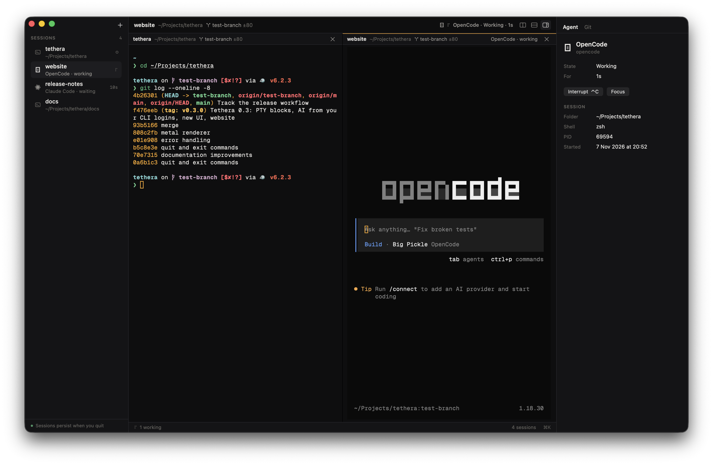

Tethera 0.4 turns Tethera into a terminal for running and supervising AI coding agents.

**Download `Tethera-macOS.dmg` below**, open it and drag Tethera to Applications. The build isn't notarized yet: the first time, right-click Tethera.app → Open → Open (or run `xattr -dr com.apple.quarantine /Applications/Tethera.app`). Requires macOS 14 or later; universal (Apple silicon + Intel).

### Sessions that persist
- Every session lives in a background daemon. Quit Tethera (⌘Q) and your shells — and the agents running in them — keep going; reopen and they're exactly where you left them. ⌥⌘Q ends them all.
- After a reboot, sessions come back with their history and folder.
- Sessions are named after their folder until you rename them; drag to reorder.
- `tethera list / new / attach / close` from any terminal, including over SSH.

### Agent-aware
- The sidebar shows which agent runs where and what it's doing: working, waiting, **needs you**, done, error. Notifications and a Dock badge when one needs you; ⇧⌘U jumps there.
- Claude Code reports its state on its own. Settings → Agents → Connect adds hooks for Claude Code, Codex, OpenCode, Hermes and Antigravity, so Tethera sees tool calls, permission requests and finished turns — and, for Claude, model, context and cost. Every config change is shown as a diff first, backed up, and reversible.
- Agents overview (⇧⌘A), an inspector with Agent and Git tabs (⌥⌘I), and a command palette (⌘K).
- Start Claude Code, Codex, OpenCode, Hermes, Gemini, Antigravity or Ollama (local models via `ollama launch`) from **+**.

### A real terminal
- Your own zsh or bash, unchanged, in GPU-rendered panes (SwiftTerm with Metal); splits with ⌘D / ⇧⌘D.
- Nerd Font prompt icons work out of the box; Geist Mono, IBM Plex Mono and JetBrains Mono bundled; ligatures off so every cell is exact.
- Graphite (dark) and Paper (light) themes, plus classic palettes.
- A new, quieter design and a new icon.

### Removed
- The v0.3 block list, custom input bar and in-app AI helpers. Agents now run in your sessions, signed in as you.
