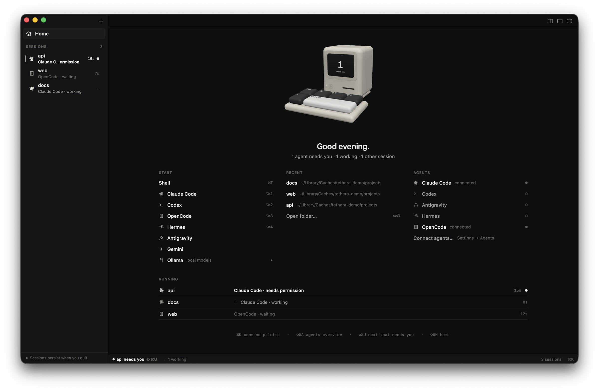

Tethera 0.5 gives Tethera a home, a new face and a new website.

**Download `Tethera-macOS.dmg` below**, open it and drag Tethera to Applications. The build isn't notarized yet: the first time, right-click Tethera.app → Open → Open (or run `xattr -dr com.apple.quarantine /Applications/Tethera.app`). Requires macOS 14 or later; universal (Apple silicon + Intel). Your sessions keep running through the update.

### Home
- Tethera opens to **Home** when nothing is running, and ⇧⌘H (or the Home row at the top of the sidebar) brings it back any time.
- Start a shell or any agent you have installed (⌥⌘1…4 for the first four), pick up one of your recent folders, see which agents are connected, and every running session, the ones that need you first.
- A small 3D computer sits on top. Its screen counts the agents that need you; its keys work: `t` opens a shell, `⌘` or `K` the command palette, `return` the agent that's waiting. It renders only while you're looking at it.

### A new look
- **Monochrome.** The amber is gone. "Needs you" is a solid dot and a bold name; red only ever means an error.
- **A new icon:** a cute retro all-in-one computer with `t_` on its screen, rendered in 3D.
- A new About window (Tethera → About Tethera).

### Website
- https://tsogbat.github.io/tethera/ is rebuilt around the same computer in 3D: press its oversized keys, scroll into its screen.

### Also
- New Shell in Folder moves to ⇧⌘O (⌘O is coming for files).
