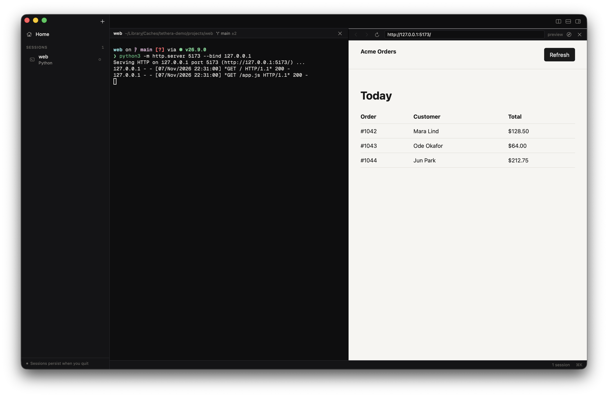

Tethera 0.6 puts your tools next to your agents: the code they change, the app they're building, the files they make, and your music.

**Download `Tethera-macOS.dmg` below**, open it and drag Tethera to Applications. The build isn't notarized yet: the first time, right-click Tethera.app → Open → Open (or run `xattr -dr com.apple.quarantine /Applications/Tethera.app`). Requires macOS 14 or later; universal (Apple silicon + Intel). Your sessions keep running through the update.

### See what your agent is doing to your code
- **Changes** (⇧⌘E, or the ± button in the title bar when the repo has changes): the session's repository, live. Files the agent just touched come first; select one for its diff. Stage, open, or discard (with a confirmation). It updates as files change, with no refresh needed.

### See what it's building
- **Preview.** When a dev server starts in a session (Vite, Next, Rails, Django, `python -m http.server`…), a **Preview :5173** button appears in the title bar. One click opens it beside the session.
- **⌘-click a localhost link** in the terminal to open it in Tethera; other links go to your browser.
- **A browser your agents can drive.** Settings → Agents → *Browser for agents* adds `tethera mcp` to Claude Code, Codex, OpenCode, Hermes or Gemini. The agent can then open pages in a tab beside its session, read them, click, type and take screenshots, using the same tool names as Playwright MCP, while you watch. Each change is shown first and is reversible, and nothing is added until you click.

### Open anything
- **An editor** in your terminal font: line numbers, syntax highlighting for the usual languages, find (⌘F), go to line (⌃G), ⌘S. When an agent changes the file you have open, it reloads by itself, or, if you've edited it too, asks: reload, keep yours, or compare.
- **Viewers** for images, PDFs, video and audio, rendered Markdown, and Quick Look for everything else.
- Open with ⌘O, from the palette, with **`tethera open <file|folder|url>`** from any session, or ⌘-click a file link.

### Music
- What's playing in Music or Spotify sits in the status bar, with play/pause and next. Click it for the artwork and controls. (macOS asks once before Tethera can control them; turn it off in Settings.)

### Also
- ⌘L opens a browser tab; ⇧⌘E shows changes.
- `tethera changes` opens the current session's changes.
