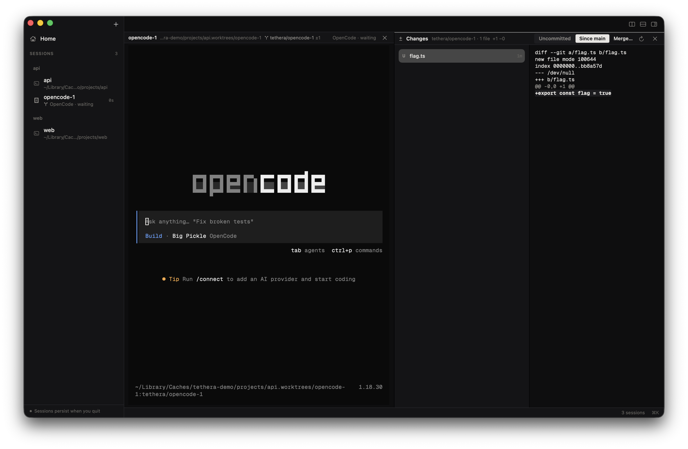

Tethera 0.7 is about running several agents at once, without them colliding and without missing one that's waiting on you.

Install or update: `curl -fsSL https://tsogbat.github.io/tethera/install.sh | bash`, `brew install --cask tsogbat/tap/tethera`, or Tethera → Check for Updates…. Your sessions keep running.

### Agents in their own worktree
- **+ → Agent in a New Worktree** (also in the palette and on Home) gives the agent its own git branch and folder next to your repo, like `api.worktrees/claude-1`. Run five on one repository; none of them step on each other or on your checkout.
- The sidebar groups sessions by repository, and marks worktree sessions with their branch.
- **Review:** Changes for a worktree shows everything since its base branch, commits included. **Merge** makes a merge commit in your checkout (nothing is pushed; refused if there's uncommitted work, aborted on conflicts). **Open Pull Request** pushes and runs `gh pr create` in a session. **Remove Worktree** cleans up the folder and branch.

### Approval inbox (⌥⌘A)
- When Claude Code asks permission to run something, it shows up in the inbox and as a notification with **Allow** and **Deny**. Answer without switching sessions.
- **Answer in terminal** hands it back to Claude's own dialog. If you answer there anyway, the request leaves the inbox.
- Requests from other agents are listed with a jump to their session.
- Already connected Claude Code? Settings → Agents shows **Update…**: the permission hook now waits for your answer (up to 10 minutes).

### Git and Homebrew
- **Git (⌥⌘G):** branches (switch, create, merge, delete), commit, fetch, pull and push, stashes, and the history graph.
- **Homebrew (⌥⌘B):** what's outdated, what's installed, search, and services. Upgrades and installs run in a Tethera session so you see the output.

### Also
- Home has a short **Get started** strip on first run.
- Segmented controls are monochrome like the rest of the app.
