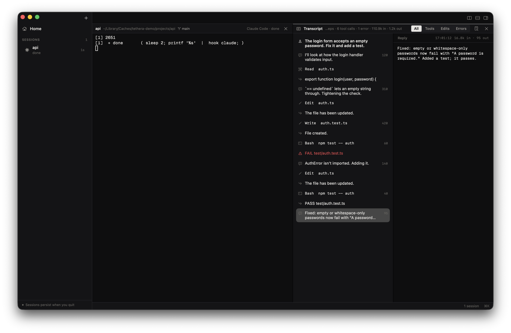

Tethera 0.8 shows you what your agents did, especially while you weren't looking.

Update with Tethera → Check for Updates…, `brew upgrade --cask tethera`, or `curl -fsSL https://tsogbat.github.io/tethera/install.sh | bash`. Your sessions keep running.

### Transcript (⌥⌘T)
- Every step a Claude Code or Codex session took: your prompts, its replies, each tool call and its result, errors in red, tokens per step.
- Click an edit to see exactly what changed. Filter to tools, edits or errors.
- It follows the session live. Also on a session's right-click menu and in the palette.

### While you were away
- Come back after 15 minutes or more (in another app, or with the Mac asleep) and Home lists what changed meanwhile: who finished, who needs you, who hit an error, each with its last message and what it spent.

### Budgets
- **Settings → General → Budgets:** set a daily spend limit, and Tethera notifies you when your agents pass it. Turn on **Pause working agents** to stop their current turn too (Escape, not quit).
- Get a warning when a session's context passes a percentage you choose.
- Spend comes from Claude Code's own cost reports (its status line). Connect it in Settings → Agents.

### Your status line, designed
- **Settings → Agents → Design the status line…:** pick model, context, cost, git branch, folder or time, with a live preview, then apply it as a reviewed change to `~/.claude/settings.json`. Your own status line command is kept.
- From the shell: `tethera statusline claude --format '{model} · {context} · {cost} · {branch}'`.

### Themes and shortcuts
- **Settings → Appearance → Import Theme…:** iTerm2 color presets (`.itermcolors`) and Ghostty theme files.
- **Settings → Shortcuts:** click any shortcut and press a new one. Conflicts are caught.

Everything here is computed from a journal kept on your Mac. Nothing leaves it.
