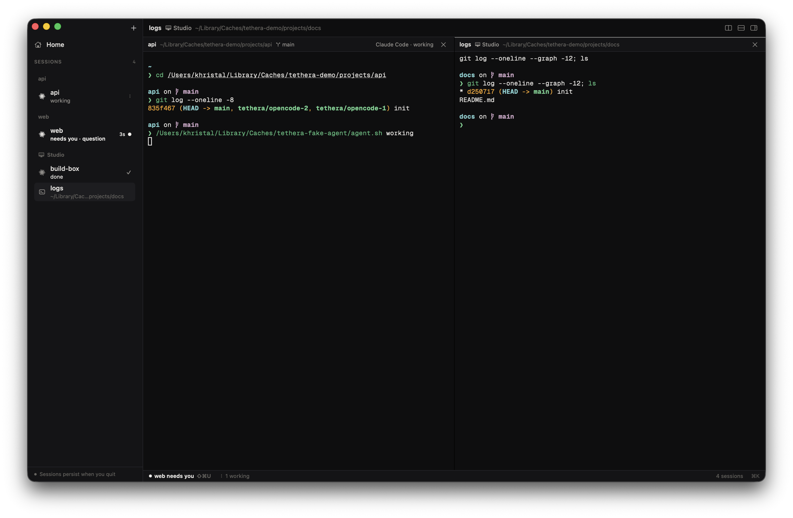

Tethera 0.9 lets you reach your agents from anywhere: another Mac's sessions in your sidebar, and the agents that need you on your phone.

Update with Tethera → Check for Updates…, `brew upgrade --cask tethera`, or `curl -fsSL https://tsogbat.github.io/tethera/install.sh | bash`. Your sessions keep running.

### Other Macs
- **Settings → Remote → Add Mac…:** enter its SSH address (a host from `~/.ssh/config`, `you@10.0.0.4`, or a Tailscale name). Tethera checks it can reach the Mac and find Tethera there before adding it.
- Its sessions show in the sidebar under its name. Attach, type, rename, interrupt and end them like your own; **+ → Shell On** starts a new one there, and ⌘T in a remote session opens the next shell on the same Mac.
- It's your own ssh (`ssh <mac> tethera bridge`), so keys, config and Tailscale SSH work as they do in Terminal. The other Mac needs Tethera installed and Remote Login on.
- Changes, Git and transcripts read files, so they stay with sessions on the Mac you're at.

### Your phone
- **Settings → Remote → Phone dashboard:** scan the QR code. The page lists your agents with their state and cost. You can **allow or deny** a permission request, or **answer** an agent's question. It can't open a shell.
- It listens on your Tailscale address (encrypted, only your devices) or, if you choose, your local network. Only a phone with the pairing code gets in, and **New Pairing Code** unpairs every phone.
- Add it to your Home Screen and it opens like an app.

### Push
- **Push to my phone while I'm away:** after two minutes away from this Mac, an agent that needs you, finishes or fails sends a push through [ntfy](https://ntfy.sh) (free, no account; or your own ntfy server). Permission requests come with Allow and Deny.
- A push carries the agent, the session's name and one line, never terminal output. Its buttons use one-time links, so your pairing code never goes through ntfy.

### Plans
- **Settings → Plan** shows Free, Pro and Team. Remote Macs, the phone and push are Pro; Team arrives in 1.0. Every plan is free during the beta. There's no account.

### Also
- `tethera new` accepts `--` before the command.
