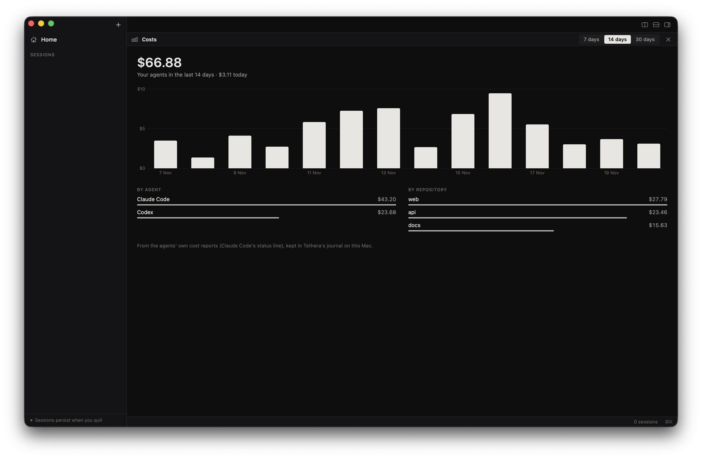

Tethera 1.0: trust it with real work. Rules that answer your agents, a record of every answer, what it all costs, a board for your team, suggestions as you type, and updates that never stop a running agent.

Update with Tethera → Check for Updates…, `brew upgrade --cask tethera`, or `curl -fsSL https://tsogbat.github.io/tethera/install.sh | bash`. Your sessions keep running.

### Approval policies
- **Settings → Policies:** rules that answer Claude Code's permission requests for you. *Allow* `npm test*`, *ask* before `git push --force`, *deny* anything with `deploy`. The first rule that matches decides, and rules work even with Tethera closed.
- An allow rule never covers a command that chains, pipes or redirects, so `npm test*` can't let `npm test && rm -rf ~` through.
- Presets to start from, and a **Try it** box that shows which rule would answer a command.

### Audit log (⌥⌘L)
- Every approval: what it was for, who answered it (you, your phone, or a rule) and when. Budget stops and sessions too. Search, then export CSV or JSON.

### Costs (⌥⌘C)
- What your agents spent each day for the last 7, 14 or 30 days, by agent and by repository, from their own cost reports.

### Teams
- A team is a private GitHub repository. **Settings → Team:** enter `owner/name` and join. Tethera uses your own `gh` login.
- **Team board (⌥⌘M):** everyone's agents, live, filtered by repository, agent or state.
- The repository's `policies.json` applies to every member, ahead of their own rules. Costs and the audit log get a Team view.
- Each member shares agent names, repositories, states, costs and approvals on their own branch, never terminal output.

### Suggestions as you type
- Gray text from your shell history; **→** or **End** takes it.
- **⌃Space** lists commands, subcommands and flags (git, npm, docker, gh, cargo, claude, codex and more), files, git branches, and npm and make scripts.
- Off in agent sessions, full-screen programs and remote sessions; **Settings → General** turns it off.

### Updates that never restart your sessions
- After an update, the session daemon hands itself over to the new version in the same process. Every shell, agent and screen carries on; the window reconnects in a moment. `tethera handover` does it by hand.
- This starts with the 1.0 daemon. If you're coming from 0.9, your sessions keep running on the 0.9 daemon, which works fine with 1.0. The 1.0 daemon takes over the next time it starts (after a restart, or Quit and End All Sessions, ⌥⌘Q), and every update after that is seamless.

### Also
- Reference docs: [the CLI](https://github.com/Tsogbat/tethera/blob/v1.0.0/docs/cli.md), [hooks, approvals and policies](https://github.com/Tsogbat/tethera/blob/v1.0.0/docs/hooks.md), [browser tools over MCP](https://github.com/Tsogbat/tethera/blob/v1.0.0/docs/mcp.md).
- VoiceOver reads sessions with their state and Mac, and offers Rename and End Session.
- `scripts/bench.sh` measures your build: on an M3 Pro, a 13 ms command round trip and a 46 ms handover with 10 live sessions.
- Settings has a Team tab, and Teams is part of the Team plan, free during the beta like everything else.
