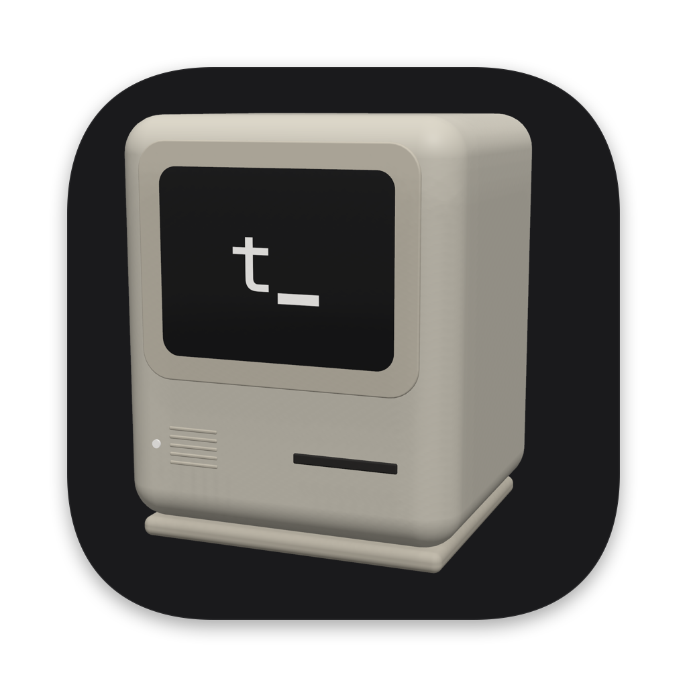
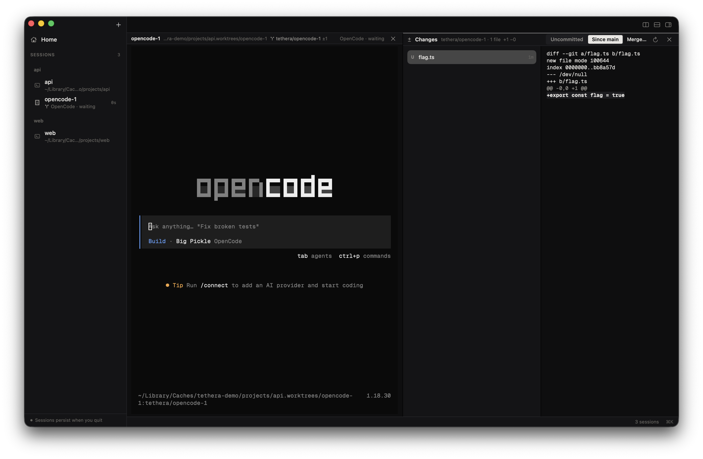
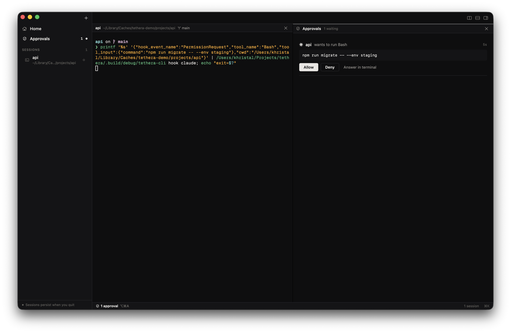
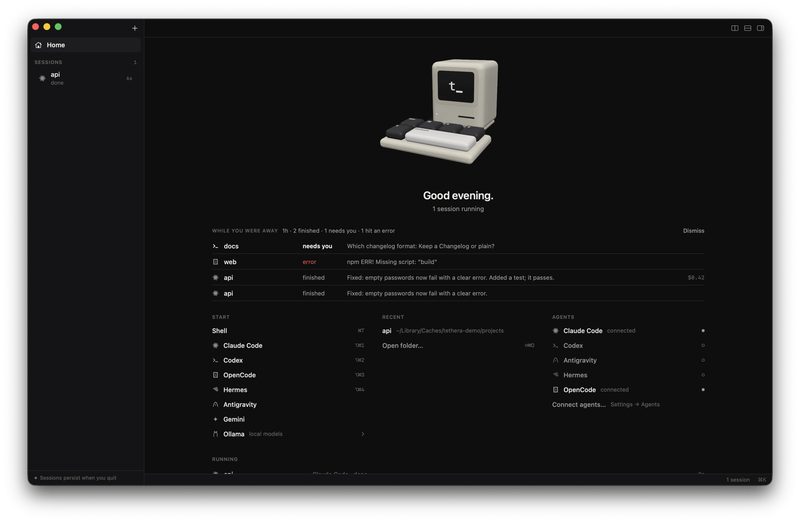
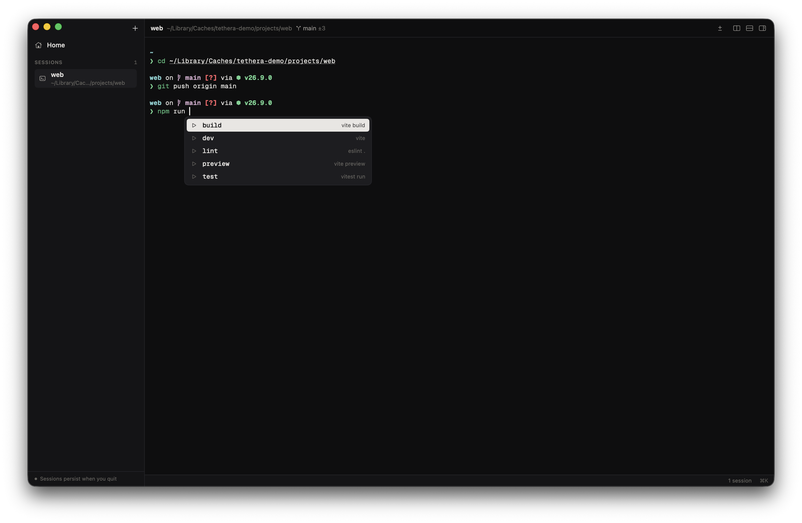
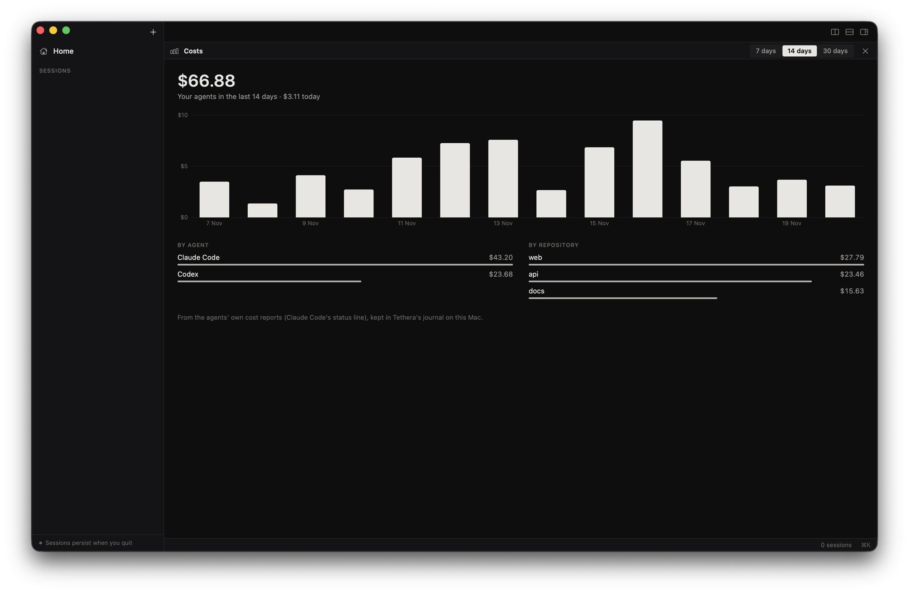
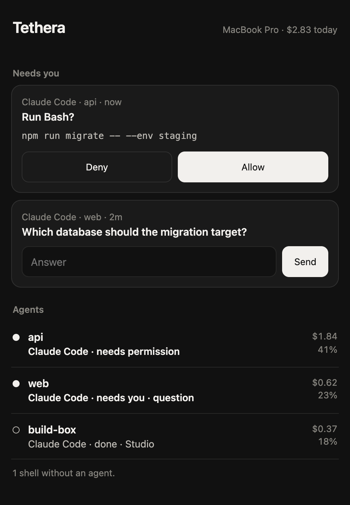
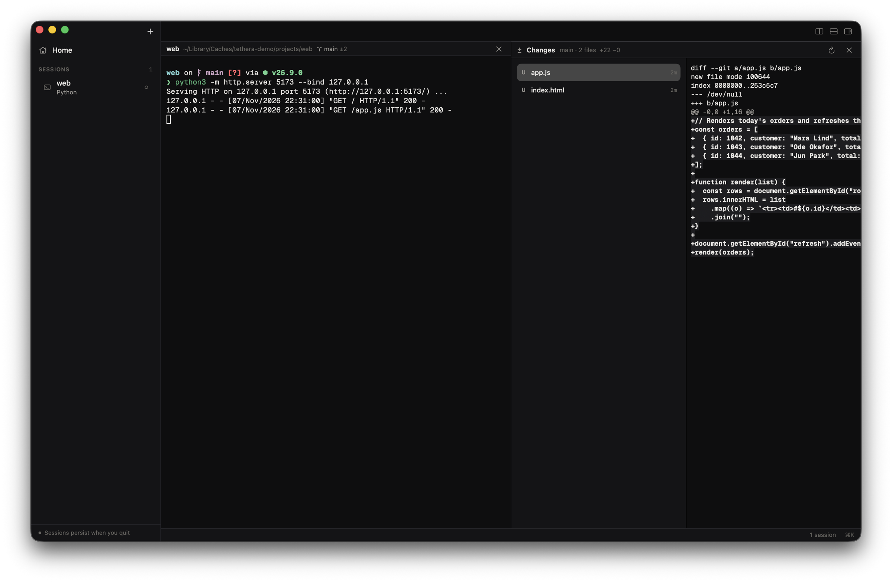
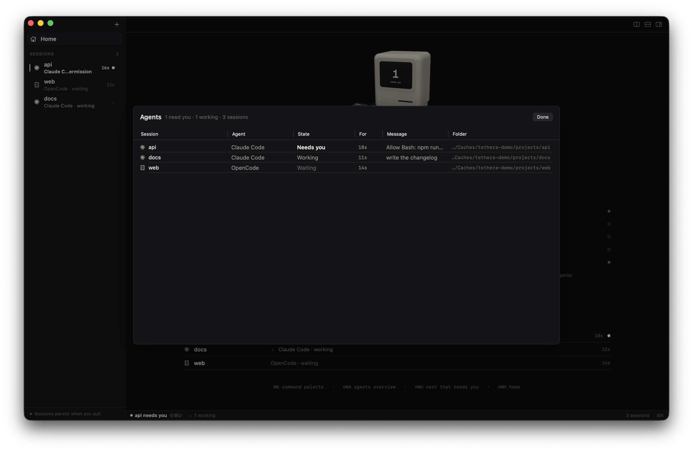

<p align="center">
  
</p>

<h1 align="center">Tethera</h1>

<p align="center">
  A terminal for running and supervising AI coding agents.<br>
  Your shell, persistent sessions, and one place to see what every agent is doing.
</p>

<p align="center">
  <a href="https://github.com/Tsogbat/tethera/releases/latest/download/Tethera-macOS.dmg"><b>Download for Mac</b></a> ·
  <a href="https://tsogbat.github.io/tethera/">Website</a> ·
  <a href="https://github.com/Tsogbat/tethera/releases">Releases</a>
</p>

<p align="center">
  
</p>

## Why

Coding agents run in terminals, and you end up with five of them in five tabs, checking each one to see if it's waiting on you. Tethera is a terminal built for that:

- **Sessions persist.** Every session lives in a small background daemon, so your shells — and the agents running in them — keep going when you quit the app, and come back exactly as they were. After a reboot they return with their history and folder.
- **Agent-aware.** The sidebar shows which agent runs in which session and what it's doing: working, waiting, **needs you**, done, error. You get a notification and a Dock badge when one needs you, and ⇧⌘U takes you there.
- **A real terminal.** Your own zsh or bash, exactly as you configured it, in fast GPU-rendered panes (SwiftTerm with Metal). TUIs, `vim`, `ssh`, Nerd Font prompts — everything works.
- **Home.** Where Tethera opens: start any agent, pick up a recent folder, see which integrations are connected and who's running — with a little 3D computer whose keys you can press.
- **Your tools, beside the agent.** The repo's changes as they happen, a preview of the app it's building, a browser it can drive, an editor and viewers for the files it makes, and your music.

## Run agents in parallel

- **An agent in its own worktree.** + → *Agent in a New Worktree* (or the palette) gives the agent its own branch and folder next to your repo (`api.worktrees/claude-1`), so five agents can work on one repository without colliding. The sidebar groups sessions by repository.
- **Review and merge.** Changes for a worktree shows everything since its base branch, commits included. Then **Merge** (a merge commit in your checkout, nothing pushed), **Open Pull Request** (`git push` + `gh pr create`, in a session), or **Remove Worktree**.
- **Approval inbox** (⌥⌘A). When Claude Code asks to run something, it lands in the inbox and in a notification with **Allow** and **Deny**, so you answer without switching sessions. **Answer in terminal** hands it back to Claude's own dialog. Other agents' requests are listed with a jump to their session.

<p align="center">
  
  
</p>

## See what your agents did

- **Transcript** (⌥⌘T). Every step a Claude Code or Codex session took: your prompts, its replies, each tool call, results and errors, with tokens per step. Click an edit to see its diff. Filter to tools, edits or errors. It follows the session live.
- **While you were away.** Come back after a while and Home lists what changed: who finished, who needs you, who hit an error, each with its last message and what it spent.
- **Budgets.** Settings → General: a daily spend limit (optionally pausing working agents), and a warning when a session's context fills up.
- **Your status line, designed.** Settings → Agents → *Design the status line…*: pick model, context, cost, branch, folder or time, see it, apply it. `tethera statusline claude --format '{model} · {cost}'` renders it.
- **Themes and shortcuts.** Import iTerm2 (`.itermcolors`) and Ghostty themes; change any shortcut in Settings → Shortcuts.

All of this comes from a journal Tethera keeps on your Mac (`~/Library/Application Support/Tethera/journal/`), nowhere else.

<p align="center">
  
  
</p>

## Trust

- **Updates that never restart your sessions.** After an update the daemon hands itself over to the new version in the same process: every shell, agent and screen carries on, and the app reconnects in a moment. (From 1.0 on; `tethera handover` does it by hand.)
- **Approval policies.** Settings → Policies: rules that answer an agent's permission requests for you, like *allow* `npm test*`, *ask* before `git push --force`, *deny* anything with `deploy`. The first rule that matches decides, even with Tethera closed. An allow rule never covers a command that chains or pipes, so `npm test*` can't let `npm test && rm -rf ~` through. Presets get you started, and a "Try it" box shows which rule would answer.
- **Costs** (⌥⌘C). What your agents spent each day, by agent and by repository, from their own cost reports.
- **Audit log** (⌥⌘L). Every approval, who answered it (you, your phone, or a rule) and when, plus budget stops and sessions. Search it; export CSV or JSON.
- **Teams.** A team is a private GitHub repository. Join it in Settings → Team, and the **Team board** (⌥⌘M) shows every member's agents live, the team's `policies.json` applies to everyone, and costs and the audit log have a Team view. Tethera talks to GitHub with your own `gh` login; each member shares agent states, costs and approvals on their own branch, never terminal output.
- **Suggestions as you type.** Gray text from your shell history; → or End takes it. ⌃Space lists commands, subcommands and flags (git, npm, docker, gh, cargo, claude, codex and more), files, git branches, and npm and make scripts.

<p align="center">
  
  
</p>

## From anywhere

- **Other Macs.** Settings → Remote → *Add Mac…*: give it an SSH address (a host from `~/.ssh/config`, `you@10.0.0.4`, or a Tailscale name). Its sessions show in the sidebar under its name, and you attach, type, rename and start new ones there as if they were local. Tethera runs `ssh <mac> tethera bridge` with your own ssh, so keys, config and Tailscale SSH just work.
- **Your phone.** Turn on the phone dashboard in Settings → Remote and scan the QR code. It lists your agents with what they cost, and lets you **allow or deny** a permission request or **answer** an agent's question. It can't open a shell. It listens on your Tailscale address by default (or your local network), and only a phone with the pairing code gets in.
- **Push.** Away from the Mac for two minutes and an agent needs you, finishes or fails: a push through [ntfy](https://ntfy.sh) (free, no account; or your own server), with Allow and Deny on permission requests.

<p align="center">
  
  
</p>

Remote Macs, the phone dashboard and push are part of **Pro**, and Teams is **Team**; Settings → Plan shows what's in each. Every plan is free during the beta.

## Tools

Tools open as panes beside the session that needs them.

| Tool | What it does |
| --- | --- |
| **Changes** (⇧⌘E) | The session's repository, live: files newest-first, the diff of the selected one; stage, open or discard. |
| **Preview** | When a dev server starts in a session, **Preview :PORT** appears in the title bar; one click opens it beside the session. ⌘-click a localhost link does the same. |
| **Browser** (⌘L) | A real browser tab. Settings → Agents → *Browser for agents* adds `tethera mcp` to Claude Code, Codex, OpenCode, Hermes or Gemini, so the agent can open pages, read them, click, type and take screenshots (Playwright MCP's tool names) while you watch. |
| **Editor** | Your terminal font, line numbers, highlighting, find, ⌃G go to line, ⌘S. When an agent changes a file you have open, it reloads — or asks, if you've edited it too. |
| **Viewers** | Images, PDFs, video and audio, rendered Markdown, and Quick Look for everything else. |
| **Music** | What's playing in Music or Spotify, in the status bar, with play/pause and skip. |
| **Git** (⌥⌘G) | Branches, commit, fetch/pull/push, stashes, and the history graph. |
| **Homebrew** (⌥⌘B) | Outdated, installed, search, services. Upgrades and installs run in a session so you see them. |

Open anything with ⌘O, the palette, or `tethera open <file|folder|url>` from a session.

<p align="center">
  
  
</p>

## Agents

| Agent | Works out of the box | With Connect (Settings → Agents) |
| --- | --- | --- |
| Claude Code | state from its own status reports (OSC 7501) | tool calls, permission requests, finished turns; model, context and cost from your status line (which keeps working unchanged) |
| Codex | detected, working/waiting | approvals, finished turns (trust the hooks once in `/hooks`) |
| OpenCode | detected, working/waiting | permission requests, finished turns (a small plugin) |
| Hermes | detected, working/waiting | tool calls, approvals, turn results (approve the hooks once) |
| Antigravity (`agy`) | detected, working/waiting | tool confirmation, cost, finished turns |
| Gemini CLI, Aider, … | detected, working/waiting | — |
| Ollama | `ollama launch claude/codex/opencode` from **+** runs agents on local models | — |

Connect shows the exact change to each config file before writing it, saves a backup, and Disconnect removes only Tethera's entries. Agents always run with your own logins — Tethera has no accounts or API keys.

Agents start inside a shell, so when one exits, the session (and its scrollback) stays.

## The window

- **Home** (⇧⌘H) — start a shell or any agent (⌥⌘1…4), recent folders, integrations, and every running session, needs-you first.
- **Sidebar** — every session, named after its folder until you rename it (double-click). A solid dot and bold name mark a session that needs you; a spinner, one that's working. The look is monochrome: red only ever means an error.
- **Panes** — ⌘D / ⇧⌘D split; ⌘W closes a pane but the session keeps running.
- **Inspector** (⌥⌘I) — the agent's state, message, current tool, model / context / cost, and Interrupt; a Git tab to stage, commit, fetch, pull and push.
- **Agents overview** (⇧⌘A) — one table of every session, sorted by what needs you.
- **Command palette** (⌘K) — sessions, new agent sessions, splits, settings.

<p align="center">
  
  
</p>

## Shortcuts

| Shortcut | Action |
| --- | --- |
| ⇧⌘H | Home |
| ⌘T | New shell session |
| ⌥⌘1…⌥⌘4 | New Claude Code, Codex, OpenCode or Hermes session |
| ⇧⌘O | New shell in a folder |
| ⌘O | Open a file |
| ⌘L | New browser tab |
| ⇧⌘E | Changes |
| ⌥⌘A | Approvals |
| ⌥⌘T | Transcript |
| ⌥⌘G · ⌥⌘B | Git · Homebrew |
| ⌘S · ⌃G | Save · go to line (editor) |
| ⌘K / ⌘P | Command palette |
| ⇧⌘A | Agents overview |
| ⇧⌘U | Go to the session that needs you |
| ⌘] / ⌘[ · ⌘1…⌘9 | Next / previous session · session by position |
| ⌘D / ⇧⌘D | Split right / down |
| ⌘W | Close pane (the session keeps running) |
| ⌥⌘W | End session |
| ⇧⌘R | Rename session |
| ⌥⌘I | Inspector |
| ⌘+ / ⌘- / ⌘0 | Font size |
| ⌘Q | Quit — sessions keep running |
| ⌥⌘Q | Quit and end all sessions |

## The `tethera` command

The session daemon is also a CLI (linked at `~/.local/bin/tethera` once you connect an agent):

```bash
tethera list                         # sessions, their agents and state
tethera new --name api --attach      # a new session, attached to this terminal
tethera attach api                   # attach from any terminal (⌃\ detaches) — also over SSH
tethera close api
tethera open src/app.ts              # open a file (or folder, or URL) beside this session
tethera changes                      # this session's live diff
tethera mcp                          # the browser, as an MCP server for agents
tethera bridge                       # this Mac's sessions over stdin/stdout (what another Mac runs over ssh)
tethera handover                     # move the running daemon to this version; sessions keep running
```

Reference: [the CLI](docs/cli.md), [hooks, approvals, policies and the journal](docs/hooks.md), [browser tools over MCP](docs/mcp.md).

## Performance

`scripts/bench.sh` measures a release build against a throwaway session store. On an M3 Pro:

| What | Time |
| --- | --- |
| Daemon start (first command) | 41 ms |
| Command round trip (median) | 13 ms |
| `seq 1 2000000` through a session | 1.4 s |
| Handover to a new daemon, 10 live sessions | 46 ms |
| App launch to ready | 0.46 s |

## Install

The quickest way, in Terminal:

```bash
curl -fsSL https://tsogbat.github.io/tethera/install.sh | bash
```

It downloads the latest release, checks its SHA-256, puts Tethera in Applications and links the `tethera` command. Or with Homebrew:

```bash
brew install --cask tsogbat/tap/tethera
```

Either way, Tethera opens straight away and updates itself (Tethera → Check for Updates…). Your sessions keep running through an update.

**Or download the [DMG](https://github.com/Tsogbat/tethera/releases/latest/download/Tethera-macOS.dmg)** and drag Tethera to Applications. Tethera isn't notarized by Apple yet, so the first time macOS says it can't verify it. Click **Done**, then open **System Settings → Privacy & Security** and click **Open Anyway** next to Tethera. You only do this once.

Requires macOS 14 Sonoma or later, on Apple silicon or Intel. Updates are signed (Ed25519) and checked before they're installed.

### Build from source

```bash
git clone https://github.com/Tsogbat/tethera.git
cd tethera
make run          # debug build
make test         # unit, protocol, daemon and real-shell tests
make app          # dist/Tethera.app and dist/Tethera-macOS.dmg (universal)
```

Needs Xcode 26 (Swift 6.2). The icon is rendered from the same SceneKit model as Home: `scripts/render_icon.sh icon`.

## What's next

Tell us in [issues](https://github.com/Tsogbat/tethera/issues) what you'd like Tethera to do next.

## Architecture

See [ARCHITECTURE.md](ARCHITECTURE.md).

## License

GNU Affero General Public License v3 — see [LICENCE.TXT](LICENCE.TXT). Bundled fonts: Geist Mono, IBM Plex Mono and JetBrains Mono (SIL OFL 1.1); Symbols Nerd Font (MIT).
