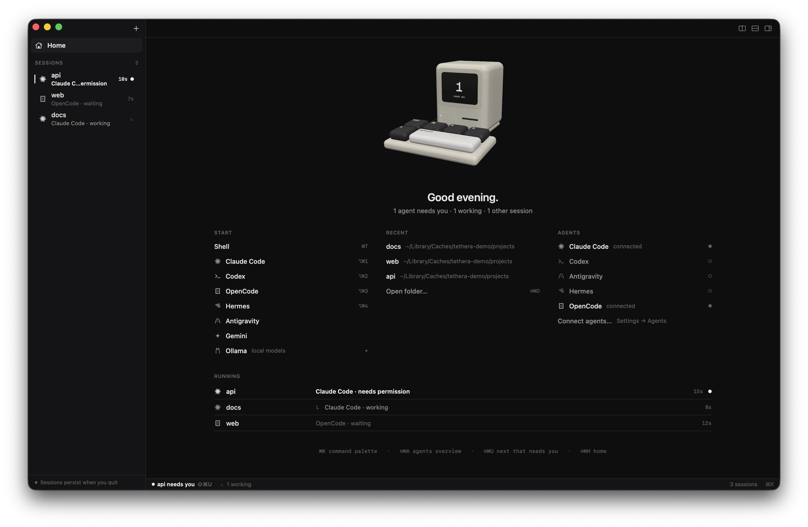
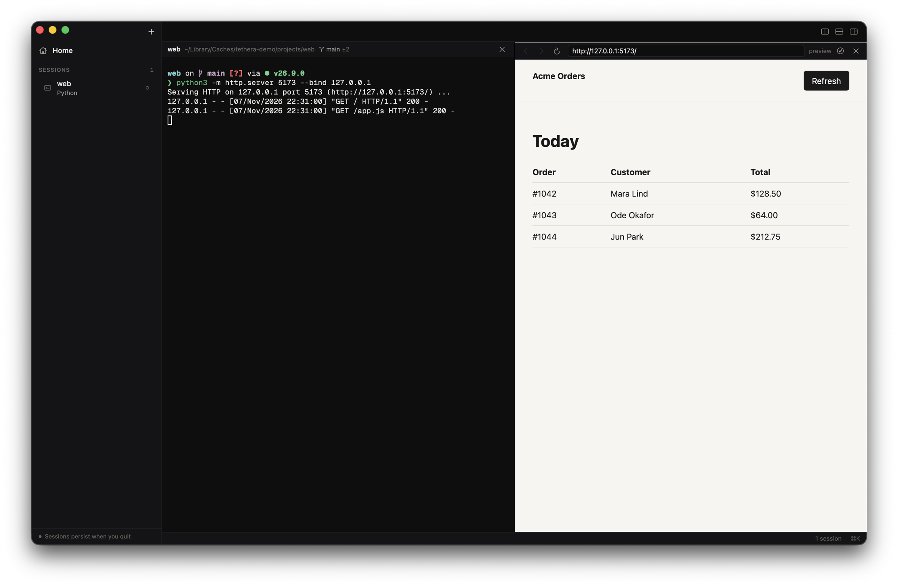
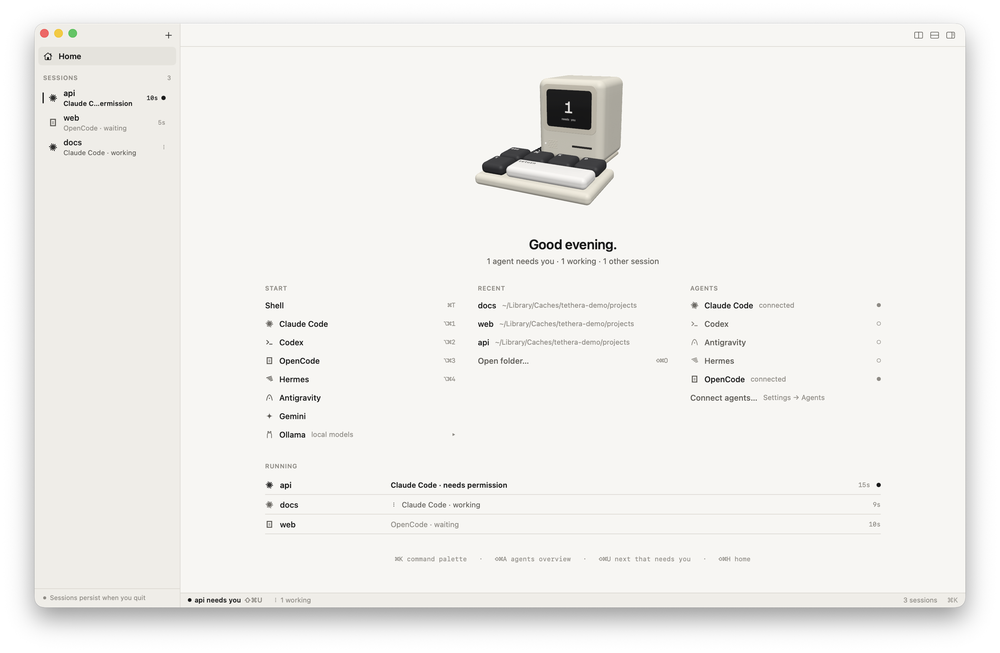

<p align="center">
  
</p>

<h1 align="center">Tethera</h1>

<p align="center">
  A terminal for running and supervising AI coding agents.<br>
  Your shell, persistent sessions, and one place to see what every agent is doing.
</p>

<p align="center">
  <a href="https://github.com/Tsogbat/tethera/releases/latest/download/Tethera-macOS.dmg"><b>Download for Mac</b></a> ·
  <a href="https://tsogbat.github.io/tethera/">Website</a> ·
  <a href="https://github.com/Tsogbat/tethera/releases">Releases</a>
</p>

<p align="center">
  
</p>

## Why

Coding agents run in terminals, and you end up with five of them in five tabs, checking each one to see if it's waiting on you. Tethera is a terminal built for that:

- **Sessions persist.** Every session lives in a small background daemon, so your shells — and the agents running in them — keep going when you quit the app, and come back exactly as they were. After a reboot they return with their history and folder.
- **Agent-aware.** The sidebar shows which agent runs in which session and what it's doing: working, waiting, **needs you**, done, error. You get a notification and a Dock badge when one needs you, and ⇧⌘U takes you there.
- **A real terminal.** Your own zsh or bash, exactly as you configured it, in fast GPU-rendered panes (SwiftTerm with Metal). TUIs, `vim`, `ssh`, Nerd Font prompts — everything works.
- **Home.** Where Tethera opens: start any agent, pick up a recent folder, see which integrations are connected and who's running — with a little 3D computer whose keys you can press.
- **Your tools, beside the agent.** The repo's changes as they happen, a preview of the app it's building, a browser it can drive, an editor and viewers for the files it makes, and your music.

## Run agents in parallel

- **An agent in its own worktree.** + → *Agent in a New Worktree* (or the palette) gives the agent its own branch and folder next to your repo (`api.worktrees/claude-1`), so five agents can work on one repository without colliding. The sidebar groups sessions by repository.
- **Review and merge.** Changes for a worktree shows everything since its base branch, commits included. Then **Merge** (a merge commit in your checkout, nothing pushed), **Open Pull Request** (`git push` + `gh pr create`, in a session), or **Remove Worktree**.
- **Approval inbox** (⌥⌘A). When Claude Code asks to run something, it lands in the inbox and in a notification with **Allow** and **Deny**, so you answer without switching sessions. **Answer in terminal** hands it back to Claude's own dialog. Other agents' requests are listed with a jump to their session.

<p align="center">
  
  
</p>

## Tools

Tools open as panes beside the session that needs them.

| Tool | What it does |
| --- | --- |
| **Changes** (⇧⌘E) | The session's repository, live: files newest-first, the diff of the selected one; stage, open or discard. |
| **Preview** | When a dev server starts in a session, **Preview :PORT** appears in the title bar; one click opens it beside the session. ⌘-click a localhost link does the same. |
| **Browser** (⌘L) | A real browser tab. Settings → Agents → *Browser for agents* adds `tethera mcp` to Claude Code, Codex, OpenCode, Hermes or Gemini, so the agent can open pages, read them, click, type and take screenshots (Playwright MCP's tool names) while you watch. |
| **Editor** | Your terminal font, line numbers, highlighting, find, ⌃G go to line, ⌘S. When an agent changes a file you have open, it reloads — or asks, if you've edited it too. |
| **Viewers** | Images, PDFs, video and audio, rendered Markdown, and Quick Look for everything else. |
| **Music** | What's playing in Music or Spotify, in the status bar, with play/pause and skip. |
| **Git** (⌥⌘G) | Branches, commit, fetch/pull/push, stashes, and the history graph. |
| **Homebrew** (⌥⌘B) | Outdated, installed, search, services. Upgrades and installs run in a session so you see them. |

Open anything with ⌘O, the palette, or `tethera open <file|folder|url>` from a session.

<p align="center">
  
  
</p>

## Agents

| Agent | Works out of the box | With Connect (Settings → Agents) |
| --- | --- | --- |
| Claude Code | state from its own status reports (OSC 7501) | tool calls, permission requests, finished turns; model, context and cost from your status line (which keeps working unchanged) |
| Codex | detected, working/waiting | approvals, finished turns (trust the hooks once in `/hooks`) |
| OpenCode | detected, working/waiting | permission requests, finished turns (a small plugin) |
| Hermes | detected, working/waiting | tool calls, approvals, turn results (approve the hooks once) |
| Antigravity (`agy`) | detected, working/waiting | tool confirmation, cost, finished turns |
| Gemini CLI, Aider, … | detected, working/waiting | — |
| Ollama | `ollama launch claude/codex/opencode` from **+** runs agents on local models | — |

Connect shows the exact change to each config file before writing it, saves a backup, and Disconnect removes only Tethera's entries. Agents always run with your own logins — Tethera has no accounts or API keys.

Agents start inside a shell, so when one exits, the session (and its scrollback) stays.

## The window

- **Home** (⇧⌘H) — start a shell or any agent (⌥⌘1…4), recent folders, integrations, and every running session, needs-you first.
- **Sidebar** — every session, named after its folder until you rename it (double-click). A solid dot and bold name mark a session that needs you; a spinner, one that's working. The look is monochrome: red only ever means an error.
- **Panes** — ⌘D / ⇧⌘D split; ⌘W closes a pane but the session keeps running.
- **Inspector** (⌥⌘I) — the agent's state, message, current tool, model / context / cost, and Interrupt; a Git tab to stage, commit, fetch, pull and push.
- **Agents overview** (⇧⌘A) — one table of every session, sorted by what needs you.
- **Command palette** (⌘K) — sessions, new agent sessions, splits, settings.

<p align="center">
  
  
</p>

## Shortcuts

| Shortcut | Action |
| --- | --- |
| ⇧⌘H | Home |
| ⌘T | New shell session |
| ⌥⌘1…⌥⌘4 | New Claude Code, Codex, OpenCode or Hermes session |
| ⇧⌘O | New shell in a folder |
| ⌘O | Open a file |
| ⌘L | New browser tab |
| ⇧⌘E | Changes |
| ⌥⌘A | Approvals |
| ⌥⌘G · ⌥⌘B | Git · Homebrew |
| ⌘S · ⌃G | Save · go to line (editor) |
| ⌘K / ⌘P | Command palette |
| ⇧⌘A | Agents overview |
| ⇧⌘U | Go to the session that needs you |
| ⌘] / ⌘[ · ⌘1…⌘9 | Next / previous session · session by position |
| ⌘D / ⇧⌘D | Split right / down |
| ⌘W | Close pane (the session keeps running) |
| ⌥⌘W | End session |
| ⇧⌘R | Rename session |
| ⌥⌘I | Inspector |
| ⌘+ / ⌘- / ⌘0 | Font size |
| ⌘Q | Quit — sessions keep running |
| ⌥⌘Q | Quit and end all sessions |

## The `tethera` command

The session daemon is also a CLI (linked at `~/.local/bin/tethera` once you connect an agent):

```bash
tethera list                         # sessions, their agents and state
tethera new --name api --attach      # a new session, attached to this terminal
tethera attach api                   # attach from any terminal (⌃\ detaches) — also over SSH
tethera close api
tethera open src/app.ts              # open a file (or folder, or URL) beside this session
tethera changes                      # this session's live diff
tethera mcp                          # the browser, as an MCP server for agents
```

## Install

The quickest way, in Terminal:

```bash
curl -fsSL https://tsogbat.github.io/tethera/install.sh | bash
```

It downloads the latest release, checks its SHA-256, puts Tethera in Applications and links the `tethera` command. Or with Homebrew:

```bash
brew install --cask tsogbat/tap/tethera
```

Either way, Tethera opens straight away and updates itself (Tethera → Check for Updates…). Your sessions keep running through an update.

**Or download the [DMG](https://github.com/Tsogbat/tethera/releases/latest/download/Tethera-macOS.dmg)** and drag Tethera to Applications. Tethera isn't notarized by Apple yet, so the first time macOS says it can't verify it. Click **Done**, then open **System Settings → Privacy & Security** and click **Open Anyway** next to Tethera. You only do this once.

Requires macOS 14 Sonoma or later, on Apple silicon or Intel. Updates are signed (Ed25519) and checked before they're installed.

### Build from source

```bash
git clone https://github.com/Tsogbat/tethera.git
cd tethera
make run          # debug build
make test         # unit, protocol, daemon and real-shell tests
make app          # dist/Tethera.app and dist/Tethera-macOS.dmg (universal)
```

Needs Xcode 26 (Swift 6.2). The icon is rendered from the same SceneKit model as Home: `scripts/render_icon.sh icon`.

## What's next

- Insight: a transcript debugger, "while you were away", budgets, a status line editor
- Remote control of your sessions, from other Macs and your phone
- Teams: a shared agent board, approval policies, a cost dashboard and an audit log

## Architecture

See [ARCHITECTURE.md](ARCHITECTURE.md).

## License

GNU Affero General Public License v3 — see [LICENCE.TXT](LICENCE.TXT). Bundled fonts: Geist Mono, IBM Plex Mono and JetBrains Mono (SIL OFL 1.1); Symbols Nerd Font (MIT).
