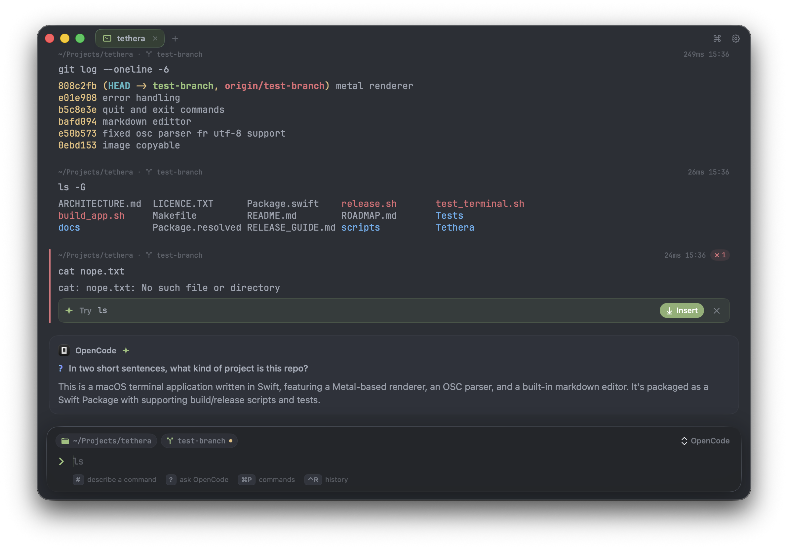
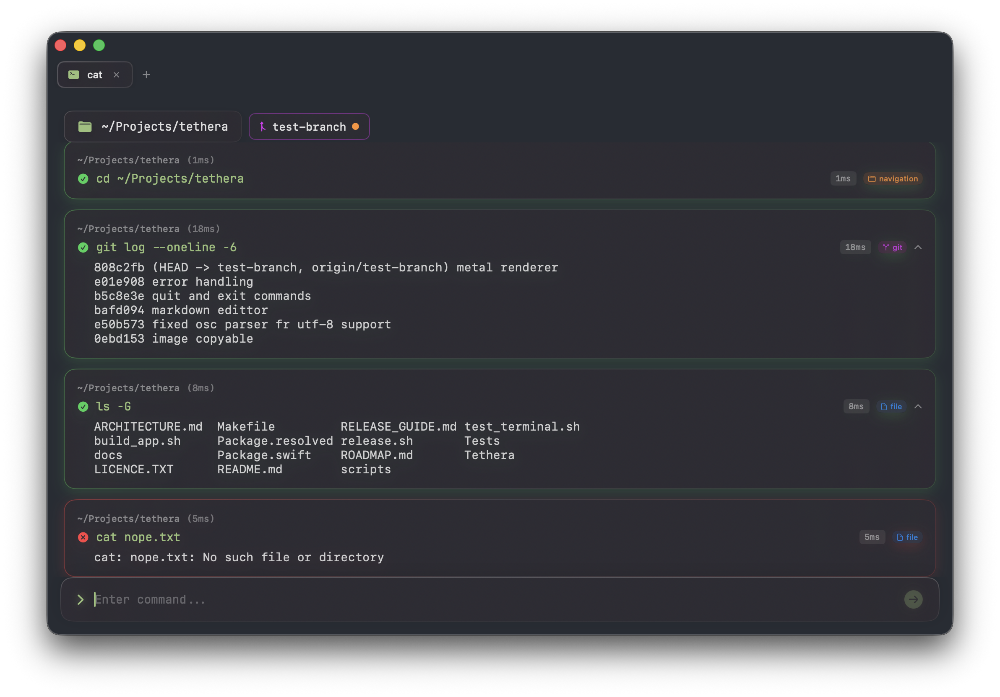
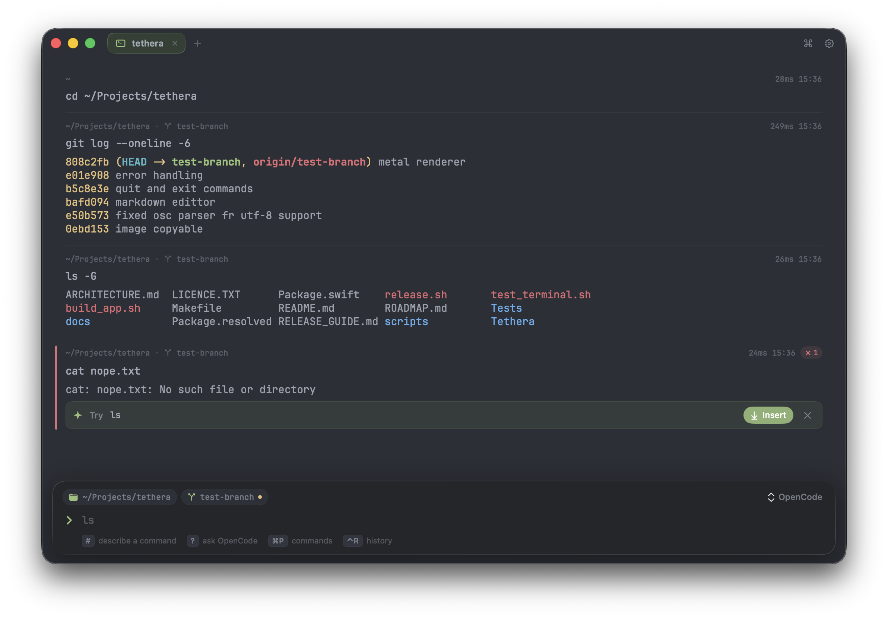

<p align="center">
  
</p>

<h1 align="center">Tethera</h1>

<p align="center">
  A block-based terminal for macOS.<br>
  Blocks for every command. AI from the CLIs you already use — no API keys.
</p>

<p align="center">
  <a href="https://github.com/Tsogbat/tethera/releases/latest/download/Tethera-macOS.dmg"><b>Download for Mac</b></a> ·
  <a href="https://tsogbat.github.io/tethera/">Website</a> ·
  <a href="https://github.com/Tsogbat/tethera/releases">Releases</a>
</p>

<p align="center">
  
</p>

## What's new in 0.3

Tethera 0.3 is a rewrite of the terminal core and the UI.

| v0.2 | v0.3 |
| :---: | :---: |
|  |  |

- **A real terminal underneath.** Every tab runs your login shell in a pseudo-terminal (SwiftTerm). Output streams live with full ANSI color, and keys go to the running program, so `vim`, `htop`, `less`, `ssh`, REPLs and `sudo` prompts all work.
- **Agents run inside.** `claude`, `codex`, `opencode`, `hermes`, `gemini` and other TUIs open full-pane with working keys, resize and mouse; finished sessions collapse back into a block.
- **AI from your own logins.** Tethera drives the coding CLIs you're already signed in to — OpenCode (free models, the default), Claude Code, Codex, Hermes, Gemini or local Ollama.
- **Race-free shell integration** for zsh and bash (OSC 133 / OSC 7), so blocks split exactly at command boundaries.
- **New design**: flat blocks with cwd · branch · duration headers, title-bar tabs, a floating input bar, Liquid Glass on macOS 26, and nine themes with full 16-color palettes.

## Features

**Blocks**
- Every command is a block: working directory, git branch, duration and an exit-code pill when it fails.
- Hover a block to rerun, edit, copy the command or output, explain or fix it with AI, or attach it to your next AI question.
- Long output collapses to its last lines, with a button to show the rest; Markdown output renders; `preview <file>` shows images inline.

**AI** (uses the CLI you pick in the input bar; tools are always off or read-only)
- `#` + plain English → a shell command in the editor. It never runs until you press ↩.
- `?` + a question → an answer block about your session, with Insert / Run on code.
- **✦ Fix** — when a command fails, a suggested fix appears under the block and as ghost text.
- **Send to agent** opens Claude Code, Codex, OpenCode, Hermes or Gemini in the pane, seeded with the block.

**Editing**
- Ghost-text completion from your history (including `~/.zsh_history`), commands and subcommands; Tab for the menu, → to accept.
- Multi-line input with ⇧↩, ↑/↓ history, ⌃R history search.

| AI provider | How Tethera calls it | Sign in with |
| --- | --- | --- |
| OpenCode *(default, free models)* | `opencode run --format json --agent plan` | `opencode auth login` |
| Claude Code | `claude -p --tools "" --output-format stream-json` | `claude` → `/login` |
| Codex | `codex exec --json -s read-only --ephemeral` | `codex login` |
| Hermes | `hermes -z` | `hermes setup` |
| Gemini CLI | `gemini -o stream-json` | `gemini` |
| Ollama | `ollama run <model>` | — (local) |

Settings → AI shows which CLIs are installed, lets you pick models, and has a Test button.

## Install

1. [Download **Tethera-macOS.dmg**](https://github.com/Tsogbat/tethera/releases/latest/download/Tethera-macOS.dmg), open it, and drag Tethera to Applications.
2. The build isn't notarized yet, so the first time, right-click Tethera.app → **Open** → **Open**. Or:
   ```bash
   xattr -dr com.apple.quarantine /Applications/Tethera.app
   ```

Requires macOS 14 Sonoma or later, on Apple silicon or Intel.

### Build from source

```bash
git clone https://github.com/Tsogbat/tethera.git
cd tethera
make run          # debug build
make test         # unit + real-shell tests
make app          # dist/Tethera.app and dist/Tethera-macOS.dmg (universal)
```

Needs Xcode 26 (Swift 6.2).

## Keyboard shortcuts

| Shortcut | Action |
| --- | --- |
| ⌘T / ⌘W | New tab / close tab |
| ⌘D / ⌘⇧D | Split right / split down |
| ⌘P | Command palette |
| ⌘F, ⌃R | Search history |
| ⌘K | Clear blocks |
| ⌘I | Toggle AI mode |
| ⌘↑ / ⌘↓ | Select previous / next block |
| ⌘⇧C | Copy selected block |
| ⌘+ / ⌘- / ⌘0 | Font size |
| ⌘, | Settings |
| ⌃C | Interrupt the running command |

## Built-in commands

| Command | Description |
| --- | --- |
| `clear` | Clear all blocks |
| `exit`, `quit` | Close the tab |
| `preview <file>`, `show <file>` | Show an image inline |

## Architecture

See [ARCHITECTURE.md](ARCHITECTURE.md).

## License

GNU Affero General Public License v3 — see [LICENCE.TXT](LICENCE.TXT).
